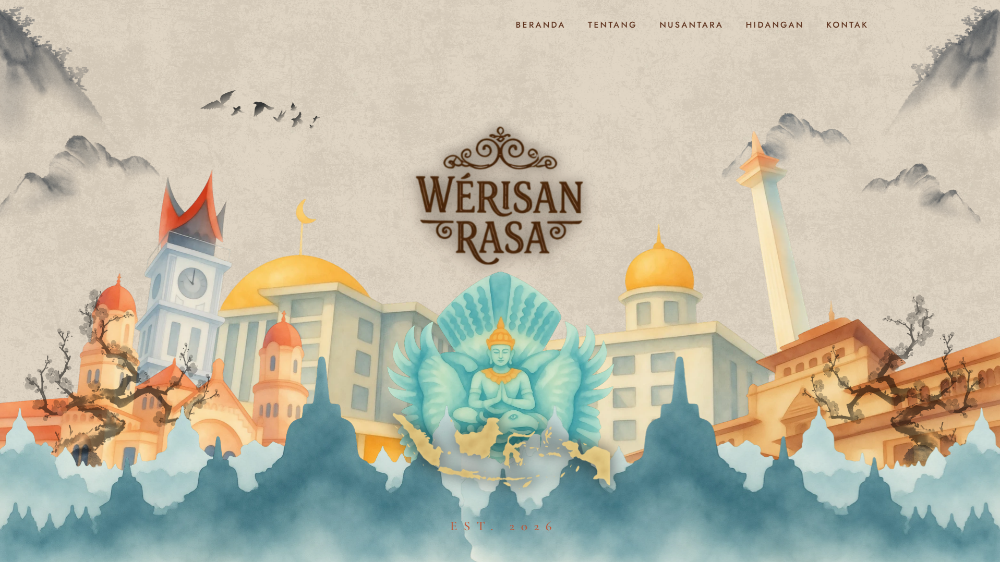

# Wérisan Rasa

> *"Rasa adalah cara paling pelan untuk pulang."*

An elegant, parallax-driven microsite for **Wérisan Rasa** (Est. 2026) a culinary heritage concept celebrating Indonesia's regional cuisines through five cities and their landmarks. Built with **React**, **TypeScript**, and **Motion (Framer Motion)**, featuring hand-illustrated watercolor/ink artwork of iconic Nusantara landmarks woven into a cinematic scroll experience.



🔗 **Live Demo:** https://werisan-rasa.vercel.app/


---

## About the Project

Wérisan Rasa ("Heritage of Taste") is a concept website that tells the story of Indonesian cuisine through five regions, each represented by a famous landmark and a curated list of signature dishes:

- **Jakarta** (Monumen Nasional): Soto Betawi, Kerak Telor, Gado-Gado
- **Bukittinggi** (Jam Gadang): Rendang, Sate Padang, Nasi Kapau
- **Semarang** (Lawang Sewu): Lumpia Semarang and more
- **Bandung** (Gedung Sate)
- **Borobudur / Garuda Wisnu Kencana**

**Sections:**
- **Hero**: a richly layered parallax illustration combining Monas, Istiqlal Mosque, Jam Gadang, Lawang Sewu, Gedung Sate, Garuda Wisnu Kencana, Borobudur, a map of the archipelago, and decorative mountains/birds, all animated with scroll-based parallax via Motion's `useScroll`/`useTransform`/`useSpring`
- **About (Tentang)**: the brand's story
- **Region Explorer (Nusantara)**: interactive exploration of each city's landmark, intro story, and dishes (typed via `Region`/`Dish` interfaces)
- **Menu (Hidangan)**: featured dishes across regions
- **Values (Cerita)**: three brand values ("Setia pada asal", "Hangat di meja", "Terbuka bercerita") with scroll-reveal animations
- **Contact (Kontak)**: a contact form (name, email, topic, message)
- **Footer**

All UI copy is written in Indonesian, matching the brand's identity.

## Tech Stack

| Category | Technology |
|---|---|
| Frontend | React 19, TypeScript, Vite 8 |
| Animation | Motion (Framer Motion): scroll-linked parallax, spring physics, reveal-on-scroll |
| Styling | Plain CSS (per-component `.css` files) |
| Assets | Hand-illustrated watercolor/ink artwork (landmarks, Garuda, map, logo) |

## Project Structure

```
werisan-rasa/
├── src/
│   ├── components/
│   │   ├── Nav.tsx / Nav.css
│   │   ├── Hero.tsx / Hero.css          # Parallax landmark illustration + logo
│   │   ├── About.tsx / About.css
│   │   ├── RegionExplorer.tsx / .css    # Interactive region/city explorer
│   │   ├── Menu.tsx / Menu.css
│   │   ├── Values.tsx / Values.css
│   │   ├── Contact.tsx / Contact.css
│   │   ├── Footer.tsx / Footer.css
│   │   └── Reveal.tsx                   # Scroll-reveal wrapper component
│   ├── data/
│   │   └── regions.ts                    # Region/dish content (Jakarta, Bukittinggi, Semarang, etc.)
│   ├── hooks/
│   │   └── useInView.ts                  # IntersectionObserver hook for reveal animations
│   ├── assets/                            # Illustrated landmarks, logo, map, decorative art (.webp)
│   ├── types.ts                           # Region & Dish interfaces
│   ├── App.tsx
│   └── main.tsx
├── index.html
├── vite.config.ts
└── tsconfig.json
```

## Getting Started

1. **Clone the repository**
   ```bash
   git clone https://github.com/WarrenBillTT/Werisan-Rasa.git
   cd Werisan-Rasa/werisan-rasa
   ```

2. **Install dependencies**
   ```bash
   npm install
   ```

3. **Run the development server**
   ```bash
   npm run dev
   ```
   Open [http://localhost:5173](http://localhost:5173) in your browser.

4. **Build for production**
   ```bash
   npm run build
   ```
   This runs a TypeScript type-check (`tsc --noEmit`) before building.

5. **Preview the production build**
   ```bash
   npm run preview
   ```

## Available Scripts

| Command | Description |
|---|---|
| `npm run dev` | Starts the development server with HMR |
| `npm run build` | Type-checks and builds the project for production |
| `npm run preview` | Previews the production build locally |

## License

This project was built for personal/portfolio use. Feel free to use it as a reference, but please don't copy it identically for your own portfolio  the illustrated artwork and regional content are original to this project.
